<p align="center">
  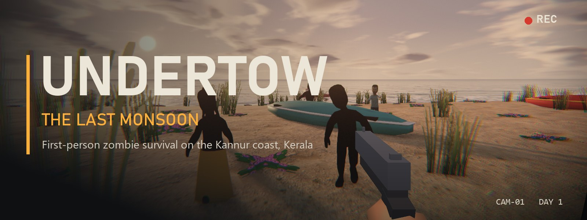
</p>

<p align="center">
  <a href="https://github.com/advaithsajith/undertow/releases/latest"></a>
  <a href="https://github.com/advaithsajith/undertow/releases/latest"></a>
  
</p>

The ferry never came back. A pathogen came ashore in a seafood company's cold chain, and the coast from
Payyambalam to Ezhimala is turning. You wash up on the beach with a pistol and a machete. Get home to Thalap,
keep your family alive through the monsoon nights, and find out what Varuna Biomarine brought into Kannur.

**Undertow** is a first-person survival shooter seen through a police bodycam: a real stretch of the North
Malabar coast, close-range gunplay, visceral melee with combos and finishers, a household to protect, and a
twelve-mission story.

<table>
  <tr>
    <td width="50%">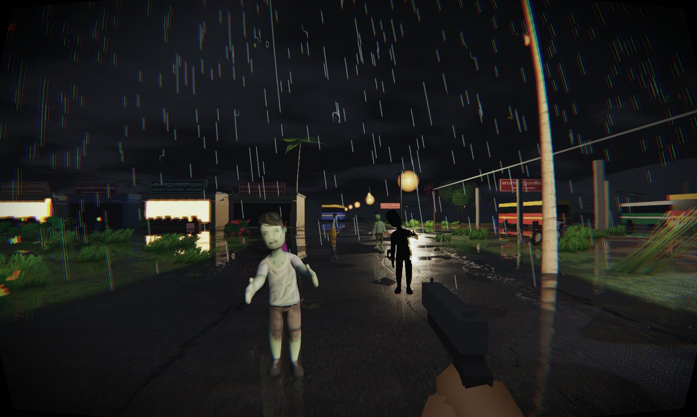</td>
    <td width="50%">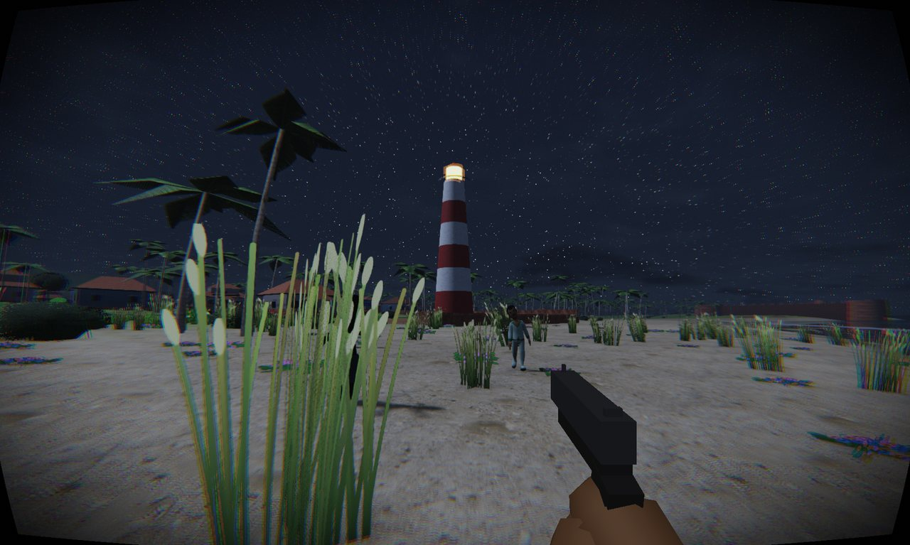</td>
  </tr>
  <tr>
    <td>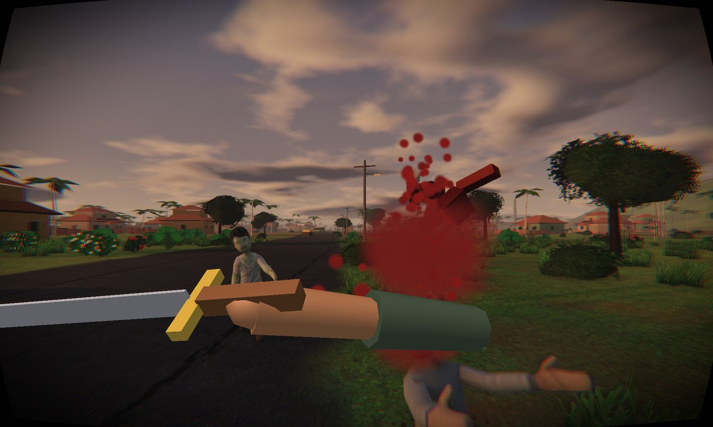</td>
    <td>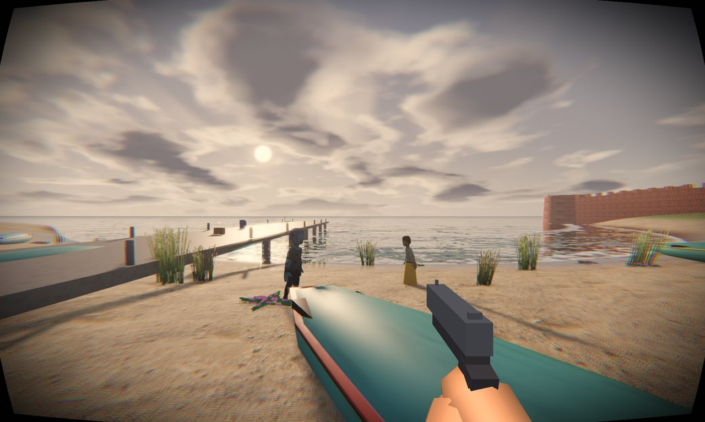</td>
  </tr>
  <tr>
    <td>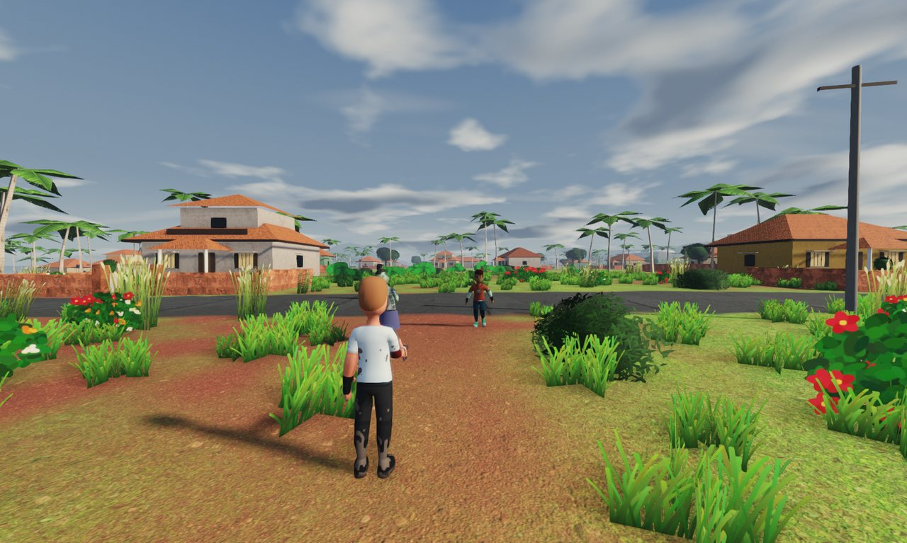</td>
    <td>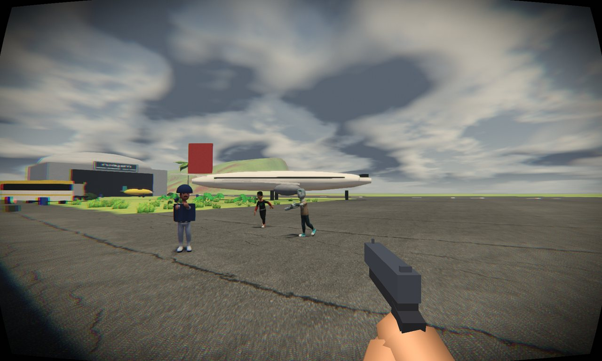</td>
  </tr>
  <tr>
    <td colspan="2">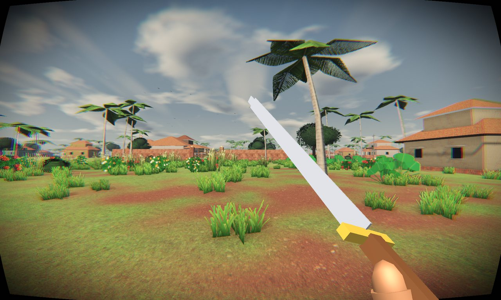</td>
  </tr>
</table>

## Play

**Windows:** download `Undertow-…-win64.zip` from [the latest release](https://github.com/advaithsajith/undertow/releases/latest),
extract it, and run `Undertow.exe`. The app isn't code-signed, so Windows may say *"Windows protected your PC"*:
click **More info → Run anyway**. `F11` toggles fullscreen.

**Any OS, in a browser:** clone or download this repo, serve the folder and open it in Chrome, Edge or Firefox:

```bash
python -m http.server 8817
```

then go to <http://localhost:8817> and click **New game**. Click the game once to capture the mouse.

A mid-range GPU runs the default *Full HD* preset. If it stutters, press `Esc` and pick *HD 720p* or *PS2 480p*.

<p align="center">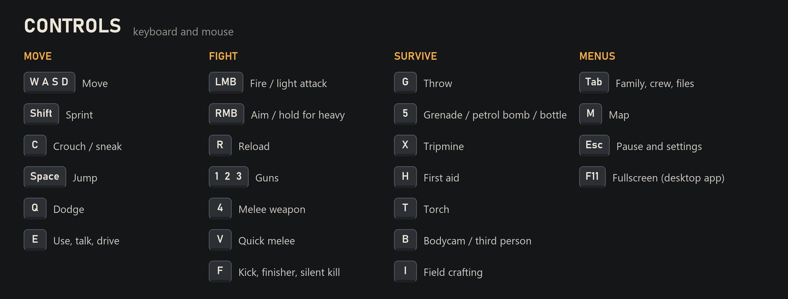</p>

## Tutorial: your first day

### 1. The beach
You start on **Payyambalam beach** at dusk. Your objective is always written top-left, a marker floats over the
target in the world, and the minimap (top-right) points the way. The first job is to walk off the beach.

### 2. Your first kills
A few **walkers** rise out of the sand.

- Hold **RMB** to aim and **LMB** to fire. A clean **headshot** pops the head of most infected. Shots to an arm
  or leg can sever it, and a legless walker will crawl after you.
- Ammo is scarce, so learn the blade. Press **4** for your machete and click to slash. Click again quickly to chain
  a **combo: slash → backhand → thrust**. The thrust lunges you forward and runs the target through.
- Hold **RMB** with a melee weapon for a **heavy** swing that knocks bodies down.
- When an infected staggers or falls, a prompt appears: press **F** to **execute** it standing or **stomp** it on
  the ground. **F** also kicks, and breaks free when something grabs you.
- **Q** dodges. Use it the moment a runner commits to a lunge.

### 3. Home
Follow the road east to the family home in **Thalap**. Achan, Amma, Muthassi and Meenu are waiting.

- **Tab** opens the household: give each person a job, read the files you've collected, and choose
  **take along** for up to two family members who will follow you and fight.
- The **workbench** in the courtyard builds guns and melee weapons, fits attachments and skins, and crafts.
- The **radio** (after the second mission) gives side jobs.
- **Rest** at the front door to pass four hours and heal.

### 4. Guns, scrap and crafting
Everything runs on **scrap**. You earn it from every kill (more for style kills like headshots, executions and
silent kills), from searching houses and shops, from finishing missions and from surviving the night.

- **New guns drop in the field.** Raiders and Varuna security often drop the weapon they were carrying, and police
  ammo crates sometimes hold a gun. Look for the amber light beam and walk over it. A new gun goes straight into a
  free slot (**1**–**3**); if you already own it, you take its ammo.
- **The workbench** builds any gun you haven't found yet, plus melee weapons like the Vaal, Urumi and spear.
- **Field crafting:** press **I** anywhere to turn scrap into ammo, first-aid kits, grenades, petrol bombs,
  bottles, tripmines, crossbow bolts, sprayer fuel and **scrap armour**, which soaks half the damage you take
  until it breaks.
- Two traders swap goods for scrap: **Kunjappan** at the Thalap tea shop and **Ummer Haji** at the Mappila Bay
  fish market.

Supplies **glint** in the world: walk up and hold **E**. Watch your **food**; the family eats every day and morale
drops when they go hungry.

### 5. Getting around
Press **E** next to a vehicle to drive it. You get the family autorickshaw after the second mission; motorcycles,
jeeps, vans and lorries are parked around the district. Fishing boats work on water only. Once you've met Rajan,
call his boat at the jetties to sail along the coast.

### 6. The siege
From the third mission on, the infected come for the house at **20:30** every night. Before dark, repair both
**gates** (hold **E** at a gate), stock up, and put your guards on watch. Fight from the courtyard until the
counter runs out. The last few stragglers come looking for you, so the night always ends. Surviving pays out
scrap.

### 7. Fighting smart
- **Stealth:** crouch (**C**) in tall grass or reeds and the HUD reads **HIDDEN**. Enemies who lose sight of you
  search where they last saw you. Walk up behind an unaware one and press **F** for a **silent kill**.
- **Cover:** walls stop bullets both ways. Crouch behind a low laterite compound wall and raiders' shots hit the
  stone.
- **Hazards:** red gas cylinders and fuel drums explode when shot, and set each other off. Pull a crowd onto
  them.
- **Lures:** throw a **bottle** (cycle throwables with **5**, throw with **G**) to pull enemies away, or drop a
  **tripmine** (**X**) on the path they'll take.
- Don't stand next to a **bloater** when it dies.

### 8. When you fall
You choose: **Retry from checkpoint** puts you back at the start of your current objective that same night, for
15% of your scrap. **Wake up at home** costs 40% and the rest of the night. Either way the mission keeps its
progress.

## Field guide

| Enemy | What to know |
| --- | --- |
| **Walker** | Slow, comes in numbers. One clean headshot or two machete hits. |
| **Runner** | Fast and fragile. Dodge the lunge, then punish it. |
| **Drowned** | Rises from the surf and grabs. Press **F** to break free. |
| **Bloater** | Huge health pool, bursts in a shower of gore when it dies. Keep your distance. |
| **Constable** / **Riot Constable** | Infected police. The riot helmet and vest soak damage until you shoot the helmet off. |
| **Spitter** | Lobs acid that pools on the ground. Close the gap or break line of sight. |
| **Screamer** | Fragile, but its scream enrages everything nearby. Kill it first. |
| **Brute** | Rare, enormous, shrugs off headshots. Explosives and heavy swings. |
| **Raiders** | Armed survivors who shoot you and the infected alike. Often drop their gun. |
| **Varuna Security** | Grey uniforms, a wave on the sleeve, rifles fired in bursts. Often drop their rifle. |
| **Survivors** | Not hostile. You *can* kill them, and your family will lose heart if you do. |

## The story

<p align="center">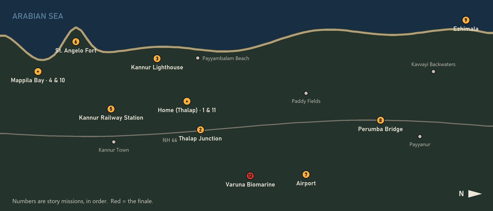</p>

Twelve missions, from getting home to a district-wide cure. Light spoilers:

| # | Mission | Where |
| --- | --- | --- |
| 1 | **Veettilekku** — The Way Home | Payyambalam beach → Thalap |
| 2 | **Marunnu** — Medicine | Thalap Junction pharmacy |
| 3 | **Vilakku** — The Light | Kannur lighthouse |
| 4 | **Kadal** — The Sea | Mappila Bay harbour |
| 5 | **Saakshi** — The Witness | Kannur railway station |
| 6 | **Kotta** — The Fort | St. Angelo Fort |
| 7 | **Pathram** — The Manifest | Kannur International Airport |
| 8 | **Paalam** — The Bridge | Perumba bridge, Payyanur |
| 9 | **Mala** — The Hill | Kavvayi backwaters → Ezhimala |
| 10 | **Ara** — The Cold Room | Mappila Bay cold store |
| 11 | **Karkidakam** — The Last Night | Home |
| 12 | **Marunnu Mazha** — Medicine Rain | Varuna Biomarine campus → the sky |

The game saves at the end of every mission and night, every 90 seconds, and from the pause menu.

## Under the hood

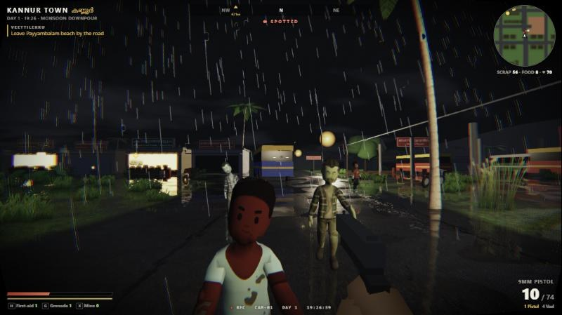

- **Engine:** three.js r128 with a custom HDR pipeline: screen-space ray-marched reflections on water and wet
  roads, ambient occlusion, contact shadows, one-bounce light, god rays, distance haze, ACES tone mapping and a
  bodycam lens (fisheye, colour fringing, vignette, rain on the lens).
- **World:** about 1.8 km of coast built from a height function and road mask. Houses get weathered plaster
  (peeling paint and rain streaks blended in the shader), wooden shutters and window sunshades. Coconut palms
  have painted frond atlases, dead hanging fronds and coconuts; broadleaf trees are leaf-card canopies.
  Walk-through foliage is streamed around the player.
- **Characters:** one skinned human mesh driven by a procedural pose system, so stagger, crawl, dismemberment
  and finishers work without animation clips.
- **Audio:** entirely synthesised in WebAudio with generated reverb; no sample files.
- **Desktop:** an Electron wrapper (`electron-main.js`) serves the same files offline.

The full build history is in [docs/DEVLOG.md](docs/DEVLOG.md).

<br clear="right">

### Settings
`Esc` → graphics preset (*PS2 480p*, *HD 720p*, *Full HD*, *4K*), foliage density, mouse sensitivity, field of
view, volume and gore. Press `B` in game to switch between the bodycam and over-the-shoulder view.

### Building the desktop app
```bash
npx @electron/packager . Undertow --platform=win32 --arch=x64 --electron-version=31.3.1 --out=../undertow-desktop --overwrite --ignore="\.md$" --ignore="^/docs"
```

### Testing hooks (browser console)
`startGame(true)`, `stepSim(seconds)`, `G.S.god = true`, `G.S.noSpawn = true`, `G.M.skip()`, `G.env.hour = 21`.
Scripts are cache-busted with `?v=N` in `index.html`; bump it after editing any file in `js/`.

## Credits and licence

Design, code and story © 2026 advaithsajith, **all rights reserved**: you're welcome to read the code and play
the game, but not to copy, modify or redistribute it without permission. See [LICENSE](LICENSE).

Built on [three.js](https://threejs.org) and [fflate](https://github.com/101arrowz/fflate) (MIT). Characters by
[Kenney](https://kenney.nl) and textures by [Poly Haven](https://polyhaven.com) (both CC0). Details in
[THIRD-PARTY-NOTICES.md](THIRD-PARTY-NOTICES.md).

*Undertow is fiction. Varuna Biomarine and its people are invented; the places are real and deserve a visit.*
